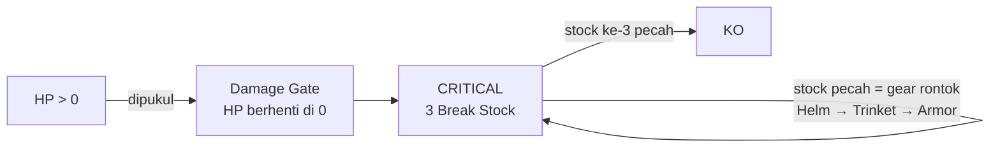
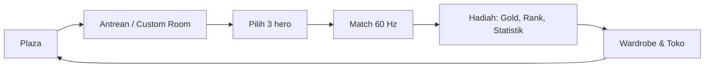
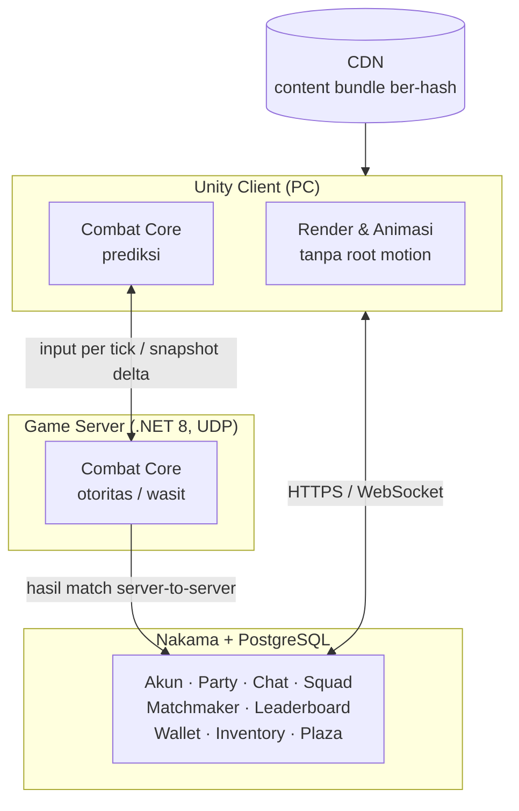
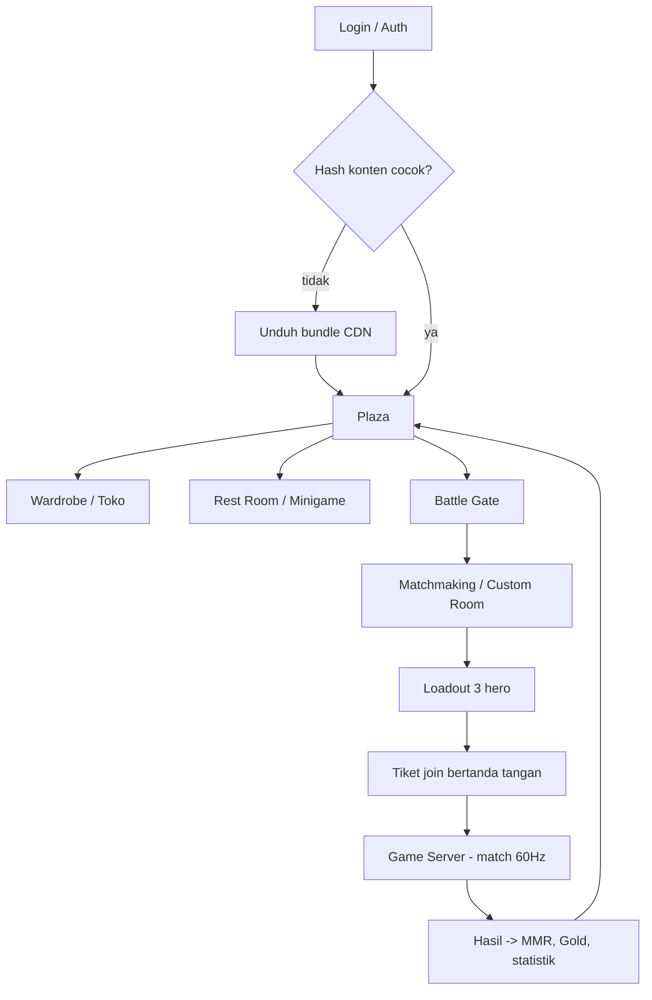
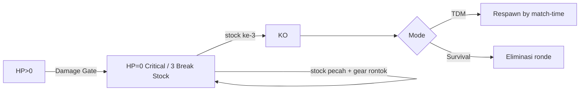

<div align="center">

# Nexus Saga: Chronicles

**Social-Competitive Action RPG Hybrid**

*Avatar sosial ala AyoDance · Brawler tim ala LostSaga · Ekonomi kosmetik non-pay-to-win*


-161A33)


</div>

---

## Daftar Isi
- [Tentang Proyek](#tentang-proyek)
- [Fitur Utama](#fitur-utama)
- [Cara Bermain (Ringkas)](#cara-bermain-ringkas)
- [Arsitektur Teknis](#arsitektur-teknis)
- [Status & Roadmap](#status--roadmap)
- [Struktur Repositori](#struktur-repositori)
- [Dokumentasi](#dokumentasi)
- [Memulai (Developer)](#memulai-developer)
- [Alur Kerja & Aturan Kontribusi](#alur-kerja--aturan-kontribusi)
- [Etika Riset](#etika-riset)
- [Lisensi](#lisensi)

---

## Tentang Proyek
**Nexus Saga: Chronicles** adalah game PC online tempat pemain memiliki **avatar** yang menjadi identitas dirinya. Pemain bersosialisasi di sebuah kota (**Plaza**), lalu bertarung dalam tim memakai **hero**, yaitu set senjata dan pakaian perang yang dikenakan di atas kostum avatar dan bisa rontok di tengah pertarungan.

Monetisasi hanya lewat kosmetik. **Uang asli membuat pemain tampil keren, bukan membuatnya lebih kuat.**

| Aspek | Ringkasan |
|---|---|
| Genre | Social-Competitive Action RPG Hybrid |
| Referensi | AyoDance (avatar & lobi), LostSaga (combat & gear), Roblox (ekonomi kosmetik, live-ops), Dota 2/MLBB (rank & statistik) |
| Format | 1v1 sampai 5v5 · mode Survival (ronde) & Team Deathmatch |
| Kamera | Arena 3D free-roam 8 arah, kamera quarter-view terkunci |
| Rating | 13+ · couple room khusus 18+ terverifikasi |
| Tim | Solo architect dibantu AI |

> Penjelasan konsep lengkap dengan bahasa sederhana: [`docs/11-konsep-game-bahasa-sederhana.md`](docs/11-konsep-game-bahasa-sederhana.md)

---

## Fitur Utama

### 🏙️ Dunia Sosial
- **Plaza**: kota untuk 30–60 pemain per instance. Pemain bisa jalan, emote, chat, dan membentuk party.
- **Rest Room**: Dance Duel (ritme 60 detik), mancing, kuis, dan couple room 18+.
- **Squad**: markas yang bisa dihias, **Squad War** mingguan yang mengubah warna dan bendera distrik kota, **Leader Duel**, dan sistem mentor.

### ⚔️ Pertarungan
- Brawler 3D dengan combo, juggle, dash, dan grab, berbasis **state machine data-driven**.
- **Guard 180° (depan saja)**: serangan dari belakang tetap kena, sehingga cross-up dan kerja sama tim bernilai.
- **Hero Swap**: 3 hero per match dengan satu HP bersama. Swap biasa 3 detik, Burst 12 detik.
- **Gear Drop**: Helm, Armor, dan Trinket bisa rontok dan **dipungut siapa saja**. Senjata tidak pernah rontok.

### ❤️ Sistem Nyawa: tidak ada mati konyol

Jatuh ke jurang **tidak** langsung mati: pemain kena fall damage (atau 1 stock pecah saat Critical), lalu **Sky-Drop** kembali ke dekat titik jatuh.

### 💰 Ekonomi Non-Pay-to-Win
| Mata uang | Sumber | Kegunaan |
|---|---|---|
| **Gold** | Bermain, minigame, quest | Hero, sewa kostum 7/30 hari, Relic |
| **Ticket** | Quest, event, battle pass | Gacha (rate dipublikasikan + pity) |
| **MiCash** | Uang asli | Kosmetik permanen, skin, battle pass premium |

Aturan pendukung:
- **Rent-to-own**: biaya sewa menjadi potongan harga untuk pembelian permanen.
- Hero yang dijual dengan MiCash **juga bisa dibeli dengan Gold**.

### 🏆 Kompetitif
Tier **Bronze → Silver → Gold → Platinum → Diamond → Mythic** (+ Top 100), dengan hidden MMR terpisah dari Rank Points.

Profil pemain menampilkan KDA, win rate, hero favorit, dan riwayat match.

---

## Cara Bermain (Ringkas)


---

## Arsitektur Teknis


| Lapisan | Teknologi | Catatan |
|---|---|---|
| Client | Unity (C#) | Pipeline avatar/wardrobe & retarget humanoid |
| **Combat Core** | Library **C# murni**, fixed-point, data-oriented | **Kode yang sama** dipakai client (prediksi) dan server (otoritas); tanpa `UnityEngine` |
| Game server | .NET 8 console + UDP (LiteNetLib) | 60 Hz, server-authoritative, lag compensation ≤ 150 ms |
| Meta backend | Nakama + PostgreSQL | Akun, sosial, matchmaker, ekonomi, Plaza |
| Konten | Addressables + CDN ber-hash | Balancing tanpa update store |
| Cadangan | Photon Quantum | Dipakai bila spike netcode custom gagal |

Detail: [`docs/08`](docs/08-arsitektur-core-combat.md) (combat) · [`docs/09`](docs/09-arsitektur-sistem.md) (sistem) · [`docs/13`](docs/13-spesifikasi-data-combat.md) (data combat) · [`docs/14`](docs/14-backend-meta-systems.md) (backend) · [`docs/18`](docs/18-arsitektur-teknis-lengkap.md) (arsitektur teknis lengkap)

### Pembagian Frontend / Backend
| Lapisan | Teknologi | Scope singkat |
|---|---|---|
| **Frontend** | Unity + URP (PC → mobile) | Render, animasi (tanpa root motion), VFX, UI/HUD, input (keyboard/gamepad/**touch**), prediksi combat, Plaza/room client. **Tidak** memutuskan damage/KO/ekonomi/MMR |
| **Combat Core (shared)** | C# murni, fixed-point, data-oriented | Simulasi deterministik; **kode sama** di client (prediksi) & server (otoritas); tanpa `UnityEngine` |
| **Game Server** | .NET 8 headless + UDP | Otoritas combat 60 Hz, snapshot/lag-comp, lapor hasil ke Nakama; stateless, scale horizontal |
| **Meta Backend** | Nakama (Go) + PostgreSQL | Auth, matchmaking, MMR (OpenSkill), lobby/room, leaderboard, wallet/inventory/shop/gacha/quest, friends/chat/party, squad/war, Plaza |
| **Konten** | Addressables + CDN ber-hash | Balancing & konten tanpa update store |

### Aset: 3D, Animasi, VFX (ringkas — detail `docs/18`)
- **3D:** shared humanoid rig, 2 base body (M/F), 13 slot kosmetik + 4 slot gear via socket; LOD wajib; `itemId` numerik + `assetKey`; material color-mask untuk Dye. **Hurtbox satu standar** (anti-P2W).
- **Animasi:** klip per (animId, frame) di-sample dari state Core; **tanpa root motion**; frame data & hitbox ada di data combat, bukan di clip; retarget dari rig bersama.
- **VFX:** **selalu kosmetik** (tidak pernah ubah sim/hitbox); pooling + LOD; hit spark via predicted event.
- **World:** Plaza modular (distrik berubah karena Squad War) + arena instance (collider diekspor ke Core). Dunia kecil-tapi-hidup → ringan untuk mobile.

### Scaling ke mobile (tanpa rombak kode)
Unity satu codebase PC+mobile · Core fixed-point jalan identik lintas perangkat · abstraksi input touch-ready sejak awal · UI resolution-independent · budget performa mobile dari awal · Addressables/CDN · payment abstraction (web top-up → IAP Play Store/App Store). Build mobile = port presentasi, bukan tulis ulang logika. Detail `docs/18 §8`.

### Flowchart: alur pemain


### Flowchart: tick combat (server & client identik)

```mermaid
flowchart LR
    I[Input] --> CMD[Command buffer] --> ST[State machine]
    ST --> PH[Physics + collision] --> PU[Push] --> HIT[Hit detection 3D + lag-comp]
    HIT --> R[Damage Gate / Break Stock] --> LD[Gear Drop / Hero Swap]
    LD --> T[Timer + animasi + quantize] --> SN[Snapshot delta]
```


### Flowchart: sistem nyawa


---

## Status & Roadmap
| Fase | Isi | Status |
|---|---|---|
| **0 — Desain & riset** | Konsep, combat, arsitektur, riset Ikemen GO & DDNet | ✅ **Selesai, dikunci** |
| **1 — Spike netcode** | Combat Core minimal + netcode, diuji pada ping 150 ms / jitter 20 ms / loss 2%; pembanding Photon Quantum | ⏳ Berikutnya (2–3 minggu) |
| **2 — Vertical slice (MVP)** | Login, Plaza, wardrobe, arena 1v1/2v2 dengan 2 hero, rank, panel developer | 🔒 Setelah spike lulus |
| **3 — Konten & sosial** | Squad War, Relic, minigame, gacha, battle pass, hero ke-3, 5v5 | 🔒 |
| **4 — Live-ops** | Season, event, mobile | 🔒 |

**Kriteria lulus spike:**

| # | Metrik | Target |
|---|---|---|
| 1 | Reaksi korban di layar penyerang | ≤ 1 frame |
| 2 | Hit-confirm misprediction | < 5% |
| 3 | Koreksi posisi korban | < 0,5 m |
| 4 | Kapasitas server | ≥ 20 match/vCPU |
| 5 | Bandwidth | < 64 kbps/pemain |

Checklist lengkap (sudah/belum) dan 15 tugas spike ada di **[`HANDOFF.md`](HANDOFF.md)**.

---

## Struktur Repositori
```
.
├── README.md                  ← kamu di sini
├── HANDOFF.md                 ← checklist status, langkah berikutnya, setup device baru
├── docs/
│   ├── 00-README.md           indeks dokumen
│   ├── 01 … 07                brainstorming, referensi, readiness (sebagian historis)
│   ├── 08-arsitektur-core-combat.md
│   ├── 09-arsitektur-sistem.md
│   ├── 10-review-kritis-v3.md
│   ├── 11-konsep-game-bahasa-sederhana.md
│   ├── 90-decision-log.md     ← semua keputusan (sumber kebenaran)
│   ├── 91-open-questions.md
│   └── research/              hasil bedah game/engine referensi
└── proposal/
    └── build_proposal.py      generator proposal PDF (PDF tidak di-commit)
```
Belum ada kode game. Folder `core/`, `server/`, `client/`, dan `tests/` akan dibuat pada Fase 1.

---

## Dokumentasi
| Untuk siapa | Mulai dari |
|---|---|
| Semua orang | [`docs/11-konsep-game-bahasa-sederhana.md`](docs/11-konsep-game-bahasa-sederhana.md) |
| Melanjutkan proyek / pindah device | [`HANDOFF.md`](HANDOFF.md) |
| Programmer combat & netcode | [`docs/08`](docs/08-arsitektur-core-combat.md) → [`docs/10`](docs/10-review-kritis-v3.md) → [`docs/research/`](docs/research/) |
| Programmer backend / sistem | [`docs/09-arsitektur-sistem.md`](docs/09-arsitektur-sistem.md) |
| Cek keputusan | [`docs/90-decision-log.md`](docs/90-decision-log.md) |

Prioritas bila ada konflik: `90-decision-log` > `08`/`09`/`10` > `11` > `01`–`07`.

---

## Memulai (Developer)
```bash
git clone https://github.com/MattYudha/Nexus-Saga.git
cd Nexus-Saga
```

| Tool | Kebutuhan |
|---|---|
| .NET 8 SDK | Combat Core & game server (Fase 1) |
| Unity Hub + Unity LTS | Client (Fase 1–2) |
| Docker Desktop | Nakama + PostgreSQL lokal (Fase 2) |
| Python 3.11 + `reportlab`, `pypdf` | Generator proposal PDF (opsional) |

Membuat ulang proposal PDF (Windows, butuh font Segoe UI):
```bash
python proposal/build_proposal.py proposal/Nexus-Saga-Chronicles-Proposal.pdf
```

---

## Alur Kerja & Aturan Kontribusi
1. **Belum ada coding game** sampai pemilik proyek memberi izin (tugas S-00 di `HANDOFF.md`).
2. Setiap keputusan baru **wajib** dicatat di [`docs/90-decision-log.md`](docs/90-decision-log.md).
3. Pertanyaan yang belum terjawab → [`docs/91-open-questions.md`](docs/91-open-questions.md).
4. Hasil riset → `docs/research/<sistem>-<game>.md`, dengan memisahkan observasi, inferensi, dan hal yang belum diketahui.
5. **Riset dulu, baru implementasi**: setiap sistem diriset dan didokumentasikan sebelum dikodekan.
6. Jangan commit file hasil ekstrak game, dump, atau rahasia (`.gitignore` sudah memblokirnya).

---

## Etika Riset
Riset game referensi bersifat **clean-room**:
- Kami mempelajari **desain dan perilaku**, lalu menulis spesifikasi dan kode sendiri.
- **Tidak** menyalin kode, aset, atau data milik pihak lain.
- **Tidak** membongkar proteksi, packer, atau enkripsi.
- **Tidak** menjalankan game ber-anti-cheat di bawah debugger.
- **Tidak** menyentuh server resmi.

Engine open-source (Ikemen GO, DDNet) dipelajari dari source code publiknya.

---

## Lisensi
Belum ada lisensi open-source. Secara default, seluruh hak cipta atas isi repositori ini dimiliki oleh pemilik repositori. Nama dan merek game referensi (AyoDance, LostSaga, Roblox, Dota 2, Mobile Legends) adalah milik pemiliknya masing-masing dan disebut hanya sebagai referensi desain.
