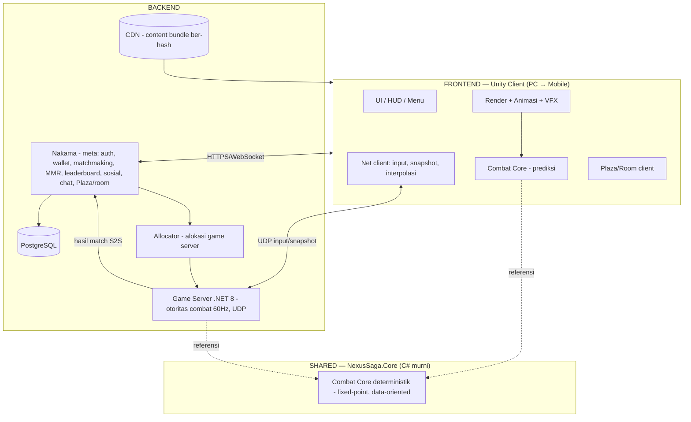
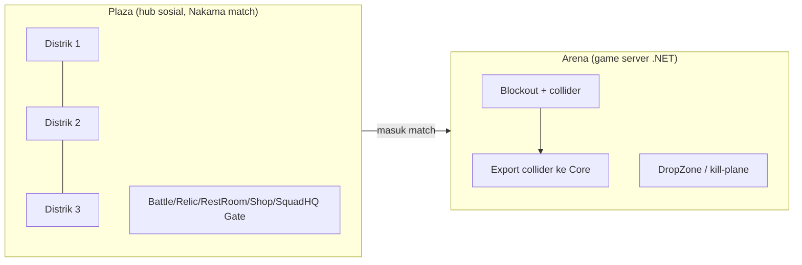
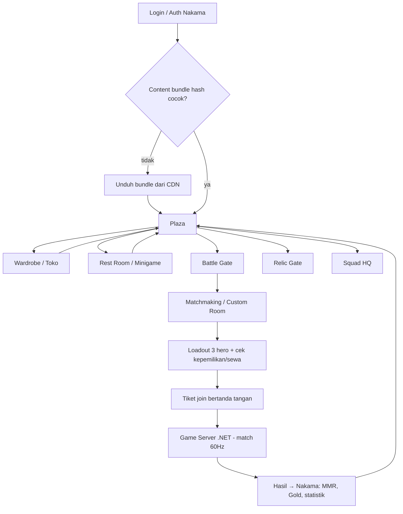
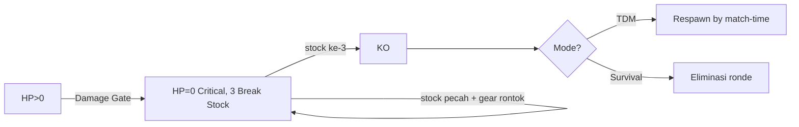
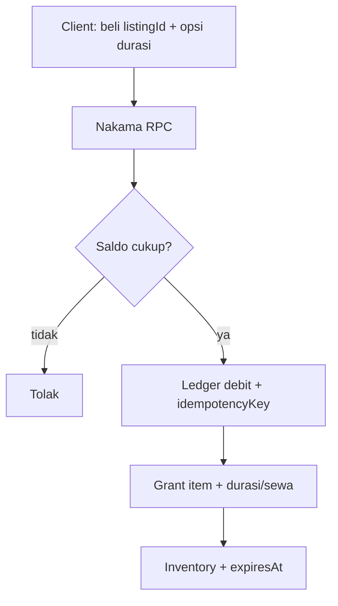

# 18 — Arsitektur Teknis Lengkap (DRAFT v0.1, 2026-10-24)

Peta teknis menyeluruh: pembagian frontend/backend, skema aset 3D/animasi/VFX, world building, pilihan teknologi yang **scalable ke mobile tanpa rombak**, pemanfaatan REA, dan flowchart logika. Menyatukan `08`, `09`, `13`, `14`. **Desain, belum ada kode.**

---

## 1. Pembagian besar (siapa mengerjakan apa)



**Prinsip pembagian:** Combat Core ditulis **sekali** (C# murni, tanpa UnityEngine) → dipakai client (prediksi) **dan** server (otoritas). Server adalah wasit; client hanya menebak dan menampilkan.

---

## 2. Frontend (Unity Client) — scope

### 2.1 Mengerjakan apa
| Area | Isi |
|---|---|
| Render | Dunia, avatar berlapis, arena, kamera quarter-view terkunci |
| Animasi | Sampling klip per (animId, frame) dari state Core; **tanpa root motion** |
| VFX | Hit spark, efek skill, aura/footstep kosmetik (nol stat) |
| UI/HUD | Menu, wardrobe preview, toko, HP/Break Stock, HUD squad, hasil match |
| Input | Abstraksi input (keyboard/gamepad **+ touch** sejak awal) → struct input Core |
| Prediksi | Jalankan Combat Core lokal untuk pemain sendiri; rollback-replay; interpolasi pemain lain |
| Plaza/Room client | Tampilkan 30–60 avatar, emote, chat; kirim gerak ke Nakama match |
| Networking client | Kirim input per tick (UDP), terima snapshot delta, dedup event prediksi |
| Content | Unduh content bundle ber-hash saat login (Addressables + CDN) |

### 2.2 TIDAK mengerjakan (otoritas server)
Damage, KO, Gear Drop, Hero Swap resolusi, hasil match, MMR, saldo wallet, kepemilikan item, gacha roll. Client hanya **mengirim input** dan **menampilkan** hasil.

### 2.3 Batas scope frontend
Frontend selesai bila: pemain bisa login → Plaza → loadout → match (prediksi mulus) → lihat hasil → wardrobe/toko, dengan semua keputusan penting divalidasi server.

---

## 3. Backend — scope (2 bagian)

### 3.1 Game Server (.NET 8) — otoritas combat
| Mengerjakan | Tidak |
|---|---|
| Simulasi combat 60 Hz via Combat Core (otoritas) | Tidak simpan akun/wallet (itu Nakama) |
| Terima input UDP, bangun snapshot delta, lag compensation ≤150 ms | Tidak render apa pun (headless) |
| Hitung damage/KO/Gear/Swap, catat statistik match | |
| Lapor hasil ke Nakama (S2S, idempoten per matchId) | |
| Banyak match per proses; stateless (bisa di-scale horizontal) | |

### 3.2 Nakama — meta backend
| Sistem | Dok |
|---|---|
| Auth, role, ban/mute | `14 §1` |
| Matchmaking + allocator | `14 §2` |
| MMR (OpenSkill) + rank | `14 §3` |
| Plaza + custom room (match label) | `14 §4` |
| Leaderboard + Top Squad | `14 §5` |
| Friends, presence, party, messenger | `14 §6` |
| Chat + moderasi | `14 §7` |
| Wallet, inventory, shop, gacha, quest | `15` |
| Squad, HQ, Squad War, community | `16` |

### 3.3 Data store
PostgreSQL (via Nakama) untuk akun/ekonomi/statistik; CDN untuk content bundle ber-hash (data hero, balancing, aset kosmetik) → **balancing tanpa update store**.

---

## 4. Skema aset 3D

### 4.1 Rig & body (fondasi semua aset)
```
SharedHumanoidRig {
  skeleton      : daftar bone standar (root, hips, spine, chest, neck, head,
                  shoulder/upperarm/forearm/hand L+R, upperleg/lowerleg/foot L+R,
                  + jari opsional minimal)
  baseBodies    : [ Male, Female ]   // proporsi berbeda, bone IDENTIK
  variation     : bone scale + blendshape (tinggi/gempal) — bukan mesh terpisah
  sockets       : titik attach per slot gear & kosmetik (lihat 4.2)
}
```
Kenapa: shared rig = animasi humanoid siap pakai (Mixamo/marketplace) bisa di-retarget; gear & kostum bisa dipertukarkan lintas hero (syarat pickup gear & wardrobe, `10 §A4`, `15 §6`).

### 4.2 Socket & layering
```
AttachSocket (per bone): Head, Face, Hair, Back, HandL, HandR, Hip, Foot...
AvatarAssembly (runtime) {
  base body (M/F) → kostum layer (13 slot kosmetik) → gear tempur (4 slot) → VFX layer
  aturan: item menempati set slot (Set mengunci Top+Bottom)
  siluet: hurtbox TIDAK bergantung mesh/kostum (konstanta bersama)
}
```

### 4.3 Format & pipeline aset
| Aspek | Keputusan |
|---|---|
| Format sumber | glTF/FBX → import Unity |
| ID | `itemId` numerik + `assetKey` (bukan nama file — pelajaran AyoDance) |
| LOD | wajib (LOD0–LOD2); penting untuk 10 pemain × banyak layer + mobile |
| Bundling | Unity Addressables, grup per kategori, **ber-hash** → unduh dari CDN |
| Skala | `scale` per item (koreksi, pelajaran AyoDance) |
| Dye | material color-mask (`dyeZones`) — sistem Dye |
| Budget | polycount & texture budget ditetapkan per kategori (mobile-first) |

### 4.4 Validasi build (otomatis)
Bone cocok rig standar; socket lengkap; LOD ada; polycount ≤ budget; siluet gear dalam batas (tidak menyamarkan hero); tidak ada mesh yang mengubah hurtbox.

---

## 5. Skema animasi
```
AnimClip {
  animId    : int
  rig       : SharedHumanoidRig
  frames    : [ { pose, duration(tick@60Hz) } ]
  events    : [ { frame, type: SFX|VFX|Footstep } ]   // kosmetik, tidak memengaruhi sim
  hitFrames : rujuk data combat (hitbox per frame, 13 §3) — BUKAN di clip
}
```
Aturan:
- **Tanpa root motion.** Gerak dari Core; Unity hanya men-sample pose per (animId, frame) dari state Core (Playables/sampling manual, bukan Animator state machine).
- **Combat frame data & hitbox ada di data combat (`13`), bukan di clip animasi.** Clip hanya visual. Ini memisahkan "rasa" (deterministik, server) dari "tampilan" (client).
- Hitbox per frame di-author dengan **Hitbox Editor** internal (tool Unity; wajib sebelum hero kedua, HANDOFF).
- Retarget: semua hero pakai rig sama → satu set animasi dasar (idle/run/jump/hit/down/getup) dipakai ulang; hanya skill unik yang baru.

---

## 6. Skema VFX
```
VfxDef {
  vfxId, assetKey
  category : enum { HitSpark, SkillFx, Aura, Footstep, Emote, Environment }
  attach   : socket | world
  lod      : [full, reduced, off]     // mobile & jarak jauh
  pooled   : true                      // object pool (hindari spawn cost)
  cosmetic : true                      // SELALU — VFX tidak pernah ubah sim/hitbox
}
```
Aturan tegas:
- **VFX murni kosmetik.** Tidak pernah memengaruhi Combat Core, timing, atau hitbox. Skin skill boleh ganti VFX, tidak boleh ubah gameplay (anti-P2W, keterbacaan).
- Hit spark dimainkan oleh **predicted event** + dedup konfirmasi server (`08 §9`).
- Budget partikel per layar (penting 5v5 + mobile); LOD & pooling wajib.
- Aura/footstep kosmetik = kategori jualan (nol stat, `12`).

---

## 7. World building

| Elemen | Keputusan |
|---|---|
| Plaza | Kota modular (tile), ringan; 30–60 pemain/instance; **distrik bisa berubah** karena Squad War (bendera/warna) |
| Arena | Level designer bikin di Unity → **collider diekspor ke data Core** (fisika arena dibuat sendiri, bukan PhysX) |
| DropZone | kill-plane + `lastGroundedPos` (Core); Sky-Drop kembali |
| Rest Room | ruang sosial + minigame (reuse Core: Chase, Brawl Ball, Target) |
| Scalability dunia | hub kecil + instance terpisah (bukan open-world) → ringan untuk mobile |
| Konten dunia | map/stage via Addressables ber-hash → map baru tanpa update store |

Prinsip: **dunia kecil tapi hidup** (pilar `01`). Geometri arena untuk gameplay dipisah dari dekorasi visual; hanya collider yang masuk Core (deterministik).

---

## 8. Teknologi & scaling ke mobile (tanpa rombak)

### 8.1 Pilihan teknologi
| Lapisan | Teknologi | Alasan scaling |
|---|---|---|
| Client | **Unity + URP** | Satu codebase PC **dan** mobile; URP ringan untuk HP |
| Combat Core | **C# murni, fixed-point** | Jalan identik di PC/mobile/server; fixed-point = deterministik lintas perangkat |
| Game server | **.NET 8 headless + UDP** | Stateless, banyak match/proses, scale horizontal (Agones/K8s nanti) |
| Meta | **Nakama (Go) + PostgreSQL** | Cluster-ready; fitur meta sudah ada |
| Konten | **Addressables + CDN ber-hash** | Tambah konten tanpa update store; unduh per platform |
| Transport | **UDP (LiteNetLib)** | Ringan; cocok mobile network |

### 8.2 Aturan "mobile-ready sejak awal" (mencegah migrasi)
1. **Abstraksi input sejak hari pertama:** semua input lewat satu layer (keyboard/gamepad/**touch**). Core menerima struct input yang sama; UI tombol virtual tinggal ditambah.
2. **UI resolution-independent** (anchor/safe-area), siap aspect ratio HP.
3. **Budget performa ditetapkan dari awal** (polycount, drawcall, partikel, tekstur) dengan target perangkat mobile menengah.
4. **LOD + Addressables** untuk aset, agar mobile unduh/muat varian ringan.
5. **Tick 60 Hz tetap**, tapi render/animasi boleh LOD; netcode tidak berubah.
6. **Tanpa API khusus PC** di Core/gameplay.
7. **Pembayaran:** abstraksi payment (web top-up sekarang; nanti tambah IAP Play Store/App Store) tanpa mengubah wallet server.

### 8.3 Jalur scaling bertahap
```
Dev lokal (1 VPS) → playtest 1 region → rilis PC multi-region (Agones fleet + Nakama cluster) → rilis Mobile (build Android/iOS, IAP) 
```
Karena Core & data identik, build mobile = **port presentasi (render/input/UI)**, bukan tulis ulang logika.

---

## 9. Pemanfaatan REA sepanjang proyek (sah, bukan membobol)
| Fase | Pakai REA untuk |
|---|---|
| Riset | ✅ Sudah: Ikemen/DDNet (open-source), LostSaga `io3dengine.dll` (tidak ter-pack) untuk referensi struktur engine/animasi; AyoDance statis |
| Pra-build | Inspeksi struktur library pihak ketiga yang kita pakai (verifikasi, lisensi) |
| QA build sendiri | **Audit build client kita**: cek tidak ada secret/kunci bocor di biner, cek string sensitif, verifikasi hanya aset yang diizinkan ikut |
| Rilis | Bandingkan versi build (compare_artifacts) untuk memastikan patch tidak membocorkan data |
| Anti-cheat ringan | Memahami permukaan serangan client kita sendiri (kita server-authoritative, jadi ini lapisan tambahan) |

Batas tetap: **tidak** membongkar proteksi/enkripsi game pihak lain, tidak membuat cheat, tidak menyentuh server resmi. REA dipakai pada **artefak milik kita** dan **referensi open-source**.

---

## 10. Flowchart logika game

### 10.1 Alur pemain (makro)


### 10.2 Tick combat (server & prediksi client identik)

```mermaid
flowchart LR
    I[Input per tick] --> CMD[Command buffer]
    CMD --> ST[State machine + ChangeState]
    ST --> PH[Physics + collision arena + lastGroundedPos]
    PH --> PU[Push antar karakter]
    PU --> HIT[Hit detection 3D + lag comp]
    HIT --> RSLT[Damage Gate / Break Stock / hitpause]
    RSLT --> LOAD[Gear Drop / Hero Swap]
    LOAD --> TMR[Timer + animasi + quantize]
    TMR --> SNAP[Server: snapshot delta]
```


### 10.3 Nyawa (makro)


### 10.4 Ekonomi / pembelian


---

## 11. Keputusan terbuka
1. Daftar bone standar final rig (minimal vs lengkap jari).
2. Jumlah base body: 2 (M/F) — konfirmasi cukup?
3. Budget performa mobile target (perangkat acuan).
4. Payment abstraction: gateway mana untuk web vs IAP mobile.
5. Self-host Nakama vs managed (biaya vs kontrol).
