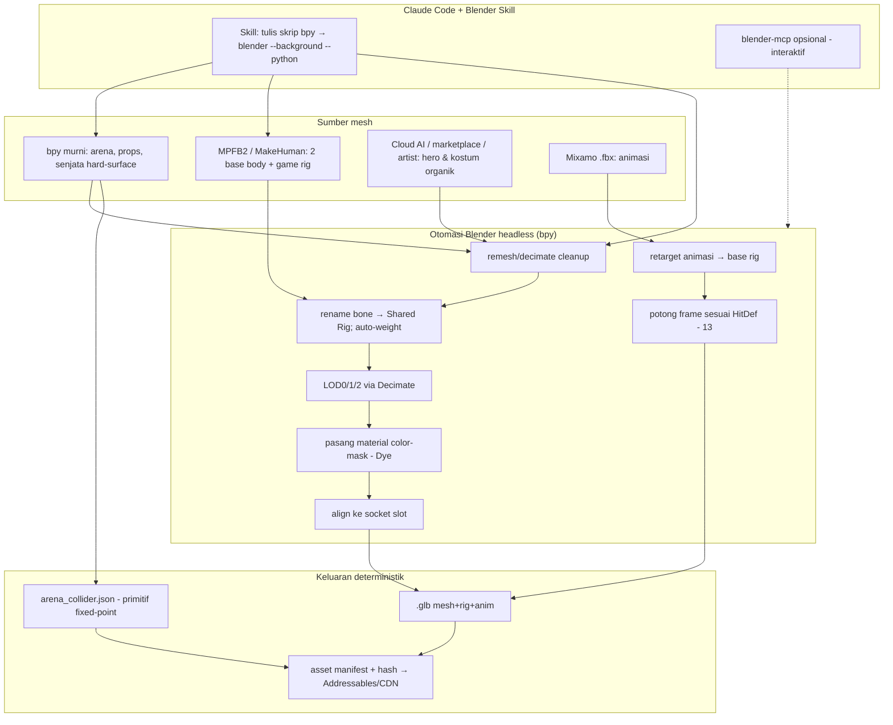

# 21 — Pipeline Aset 3D & World Building (Claude + Blender headless) (2026-10-24)

Tujuan: mempercepat pembuatan aset 3D & world building dengan **Claude mengendalikan Blender headless** (bpy) lewat kode, meminimalkan klik GUI. Berisi penilaian **jujur** (apa yang realistis di mesin ini), skema pipeline, dan keputusan engine client.

---

## 0. Koreksi realitas (wajib dibaca dulu)
Teks usulan benar di banyak hal, tapi **dua klaim perlu dikoreksi**:

### ⚠️ K1. GPU ini TIDAK cukup untuk AI-mesh-gen lokal (TRELLIS / Hunyuan3D-2)
- Mesin ini: **GTX 1650, 4 GB VRAM** (terkonfirmasi).
- TRELLIS & Hunyuan3D-2 praktis butuh **8–16 GB+ VRAM**. Yang mengikat bukan versi CUDA, tapi **VRAM**. Di 4 GB, model ini **kemungkinan besar OOM / tidak jalan / sangat lambat**.
- **Konsekuensi:** generate mesh karakter/gear organik **secara lokal di PC ini = tidak realistis.** Jangan rencanakan itu sebagai jalur utama.
- **Alternatif sah:** (a) **API cloud** untuk TRELLIS/Hunyuan/Meshy/dll (bayar per-gen, tanpa GPU lokal); (b) **marketplace asset** (stylized pack) + edit; (c) **komisi artist** untuk hero signature. Claude tetap mengotomasi *pasca-proses* (cleanup, rig, LOD, export) apa pun sumbernya.

### ⚠️ K2. LLM buruk membuat mesh organik dari bpy murni
Teks ini jujur menyebutnya, dan benar: Claude menulis bpy untuk wajah/rambut = hasil kaku (kotak/bola). Jadi **bpy murni hanya untuk hard-surface/arena/props/otomasi**, bukan karakter organik.

**Kesimpulan jujur:** pipeline "Claude + Blender" **sangat kuat** untuk **arena, world, collider, rigging, LOD, retarget, export** — dan itu justru bagian yang paling memakan waktu manual. Untuk **mesh karakter organik**, sumbernya dari luar (cloud AI / marketplace / artist), Claude yang mengotomasi sisanya.

---

## 1. Keputusan engine client: **tunda, dan spike tidak butuh engine**
- **Spike Fase 1 = pure .NET headless** (`20`). **Tidak perlu Unity/Godot sama sekali.** Jadi keputusan engine **tidak memblokir** apa pun sekarang.
- **Godot 4 .NET vs Unity** diputuskan di **awal Fase 2** lewat bake-off singkat (2–3 hari), bukan dari hype.

| Kriteria | Unity | Godot 4 .NET |
|---|---|---|
| Combat Core C# dipakai apa adanya | ✅ | ✅ (sama-sama .NET) |
| File teks ramah Claude (scene/resource) | ⚠️ YAML besar | ✅ `.tscn/.tres/.gdshader` teks ringkas |
| Scripted build / CLI (tanpa GUI) | ✅ (ada) | ✅ (headless export) |
| **Export mobile Android/iOS matang** | ✅ sangat matang | ⚠️ .NET mobile export lebih muda — **risiko utama** |
| Pipeline avatar/wardrobe & skinned-mesh-combine | ✅ matang | ⚠️ perlu dibangun |
| Ekosistem asset/tenaga | ✅ terbesar | ⚠️ lebih kecil |
| Ringan di dev (GTX 1650) | OK | ✅ sangat ringan |

**Rekomendasi jujur:** keinginan Anda "code-first, Claude-driven, minim klik GUI" membuat **Godot 4 .NET menarik**. Tapi **risiko terbesar = export mobile**, dan mobile ada di roadmap. Jadi:
- **Jangan lock sekarang.** Bake-off Fase 2 menguji 3 hal pada KEDUA engine: (1) export Android nyata di satu device, (2) import glTF+rig hasil pipeline kita secara scripted, (3) skinned-mesh-combine (`19 #1`) feasible.
- Keputusan diambil dari hasil bake-off, dicatat di decision log. Core & server tidak terpengaruh apa pun hasilnya.

---

## 2. Arsitektur pipeline aset (Claude-driven)

## 3. Pembagian tugas (apa yang Claude+bpy BISA vs TIDAK)
| Tugas | Siapa | Catatan |
|---|---|---|
| **Arena/stage + DropZone** | ✅ Claude + bpy | Bangun geometri + **ekspor collider primitif JSON** (`19 #2`) — langsung dipakai spike S-04 |
| **Props / senjata hard-surface / furnitur Plaza** | ✅ Claude + bpy / low-poly | Kotak, pedang, perisai, item drop |
| **2 base body + game rig** | ✅ Claude + **MPFB2** (Python API) | Output base body + Shared Humanoid Rig |
| **Rigging/bone-rename/auto-weight** | ✅ bpy | Seragamkan ke rig standar |
| **LOD0/1/2** | ✅ bpy Decimate | Wajib untuk mobile |
| **Material color-mask (Dye)** | ✅ bpy | Sistem Dye (`15`, `18`) |
| **Retarget animasi Mixamo + potong frame** | ✅ bpy | Idle/run/jump/hit/down/getup + skill |
| **Mesh karakter organik (wajah/rambut/kostum)** | ❌ bukan bpy murni | Sumber: cloud AI / marketplace / artist; Claude pasca-proses |
| **Hitbox per frame** | ✅ tool terpisah (Hitbox Editor) | Di engine, bukan Blender |

## 4. Setup yang dibutuhkan (untuk dipasang nanti, bukan sekarang)
1. **Blender** (LTS) — untuk bpy headless. Belum terpasang.
2. **MPFB2** add-on (CC0) — base body + rig.
3. **blender-mcp** (opsional, via `uvx` — sudah ada) untuk mode interaktif; untuk pabrik aset cukup **Custom Blender Skill** (`blender --background --python`).
4. (Opsional) akun **API cloud 3D-gen** bila mau AI-mesh untuk gear/kostum (karena VRAM lokal tak cukup).

## 5. Keluaran kontrak (agar konsisten dgn Core & engine)
| Artefak | Format | Dipakai oleh |
|---|---|---|
| `arena_<id>_collider.json` | primitif fixed-point (AABB/OBB/cylinder/ramp/dropzone) | Combat Core (deterministik) |
| `arena_<id>.glb` | mesh visual | engine client |
| `hero_<id>.glb` | mesh + Shared Rig + LOD + socket | engine client |
| `anim_<name>.glb/.anim` | klip ter-retarget | engine client (sampling per frame, `18 §5`) |
| `asset_manifest.json` | id numerik + assetKey + hash | Addressables/CDN (`15`, `18`) |

## 6. Urutan pemakaian pipeline (sinkron dgn fase)
1. **Sekarang → mendukung Spike:** Claude+bpy bangun **training arena + collider JSON** (tanpa engine, output dipakai S-04). Ini satu-satunya aset yang spike butuh.
2. **Fase 2:** base body (MPFB2) + rig + 2 hero (sumber mesh eksternal, Claude rig/LOD/export) + animasi retarget + Hitbox Editor.
3. **Fase 3+:** katalog kosmetik, Plaza/world, map tambahan.

## 7. Rekomendasi jujur (ringkas)
- **Pakai** pipeline Claude+Blender headless untuk arena/world/collider/rig/LOD/retarget/export — ini akselerasi nyata & hemat waktu manual.
- **Jangan** andalkan AI-mesh-gen **lokal** di GTX 1650 4 GB; pakai cloud/marketplace/artist untuk mesh organik.
- **Engine client:** tunda; spike headless; bake-off Godot vs Unity di Fase 2 dengan fokus **export mobile**.
- Core, server, Nakama **tidak berubah** apa pun hasil keputusan engine.

## 8. Keputusan terbuka
1. Engine client: Unity vs Godot 4 .NET (diputuskan via bake-off Fase 2).
2. Sumber mesh organik: cloud AI (mana), marketplace, atau artist?
3. Pasang Blender + MPFB2 sekarang (untuk arena spike) atau saat Fase 2?
4. Anggaran cloud 3D-gen (bila dipakai).
